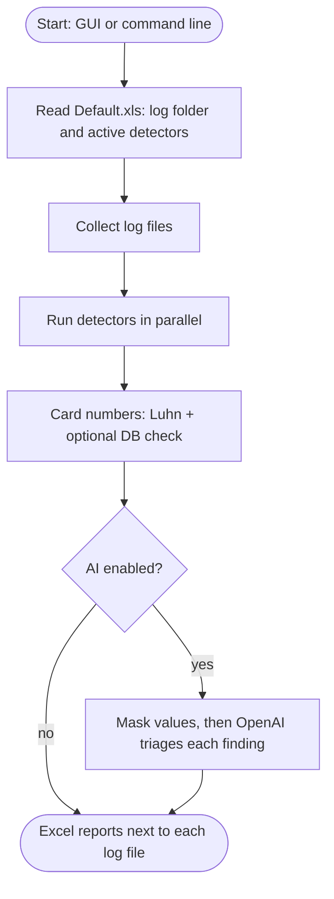

# LogCheck

Scans application log files for sensitive data that should never be logged: card numbers, SSNs, passwords, PINs and CVCs, database connection strings, card track data, cryptographic keys, bank account numbers, session tokens and software versions. Findings are written to Excel reports next to the logs.

## Features

- 11 built-in detectors, each switched on or off in `Default.xls`
- Card numbers are Luhn-checked and can be verified against a card database (BIN list over JDBC)
- Optional AI triage of findings (OpenAI), off by default; detected values are masked before anything is sent (see [Data handling](#data-handling))
- Parallel scanning; very large log files are split automatically
- GUI with start, pause, resume and stop, or a command-line mode

## How it works



## Requirements

- Windows
- Python 3.12 or newer
- Optional, for the card database check: Java and the Informix JDBC driver in `lib\` (see [lib/README.txt](lib/README.txt))

## Quick start

```bat
git clone https://github.com/Faizan-Ali-code/LogCheck.git
cd LogCheck
copy Default.sample.xls Default.xls
run.bat
```

In `Default.xls`, set `Logs Folder Path` and mark the detectors you want with `Y`. The first run creates a `.venv` folder and installs the packages. Use `run.bat --cli` for the command-line mode.

**Card database check (optional)**

1. Create a key once and set it as the `AUTOLOGGER_DB_KEY` environment variable:
   `python -c "import secrets; print(secrets.token_hex(16))"`
2. Run `Encrypt-Password.bat` and put the result after `;password=` in the `DB String` of `Default.xls`.
3. Set `AUTOLOGGER_BIN_QUERY` to a query that returns your card BINs.

**AI triage (optional, off by default):** set `openai.enabled=true` in `openai-config.properties` and the `OPENAI_API_KEY` environment variable. Read [Data handling](#data-handling) first and check that your organisation allows log excerpts to be sent to an external service.

## Data handling

- Everything runs locally. Nothing leaves the machine unless AI triage is switched on.
- With AI triage on, card-number findings and findings on DEBUG/TRACE lines are never sent. For every other finding, the request contains the detector name, the detected value **reduced to its format** (`Hunter2!` becomes `Aaaaaa9*`, `123-45-6789` becomes `999-99-9999`) and the evidence window with every value-like part masked the same way (`key=value` pairs, digit runs, long tokens). Key names and ordinary words stay, because the verdict depends on them. See `autologger/ai/redaction.py` and `tests/test_ai_redaction.py`.
- The AI verdict is a triage aid only. Its effect on false positives has not been measured yet, so review findings yourself.
- The local Excel reports contain the real values they found: store them as securely as the logs themselves.

## Output

- `<log name>-<detector>-Summary_Report.xlsx`: one row per finding, with evidence and verdict
- `<log name>-Overall_Status.xlsx`: totals per detector and file
- `Applogs\autologger3.log`: the tool's own log

## Project structure

```
autologger/          Python package: detectors, card checks, AI verifier, GUI
Default.sample.xls   settings template (copy to Default.xls)
lib/                 place for the optional JDBC driver
run.bat              starts the app (creates .venv on first run)
```

> Only scan logs you are authorised to access. Reports contain the sensitive values they found; store them securely.
